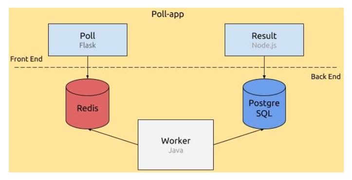

# Bernstein

Orchestrate containers using Kubernetes

This project is part of the `DevOps - Orchestration` module (`G-DOP-500`)

Main repository url: https://github.com/hugoschool/bernstein

## Application

The "poll" application is made of 3 different services:
- A poll which is a voting page that pushes the result to a Redis queue
- A worker which takes the results in the Redis queue and pushes it to the PostgreSQL database
- A result which displays the content of the PostgreSQL database

Both a Redis & a PostgreSQL database are also setup within this project

To know more, read the [README in poll-application](./poll-application/README.md) or the [school subject](./bernstein-project.pdf).

## Deploy

Please consult the [docs/deploy.md](./docs/deploy.md) document.

## Authors

This project is brought to you by:
- [Hugo ARNAL](https://hugoarnal.com)
- [Bastien SUKIENNIK](https://github.com/bsukiennik)
