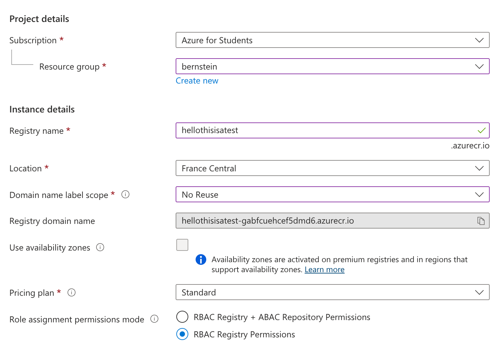

# Docker Registry

This guide is going to use the Azure Container Registry as an example.

## Creation of the registry

On the container registry creation page on Azure, here's what to fill.



Create a resource group

Set the Registry name to whatever you want

Recommended: Set the Domain name label scope to No scope

Make sure to note the registry domain name.

## Logging in

Once created, go to the repository permissions, then token.

Create a token for your account. Once created, use the password to log into docker on your local machine. If the command isn't given, here's an example: `docker login -u <TOKEN_NAME> -p <TOKEN_PASSWORD> <REGISTRY_DOMAIN_NAME>`

## Create the Kubernetes secret

You can create the Kubernetes secret yourself if needed (it will automatically be created by the deploy.sh script):

```sh
kubectl create secret docker-registry registry-key \
    --docker-server=$DOCKER_REGISTRY \
    --docker-username=$DOCKER_USERNAME \
    --docker-password=$DOCKER_PASSWORD
```
