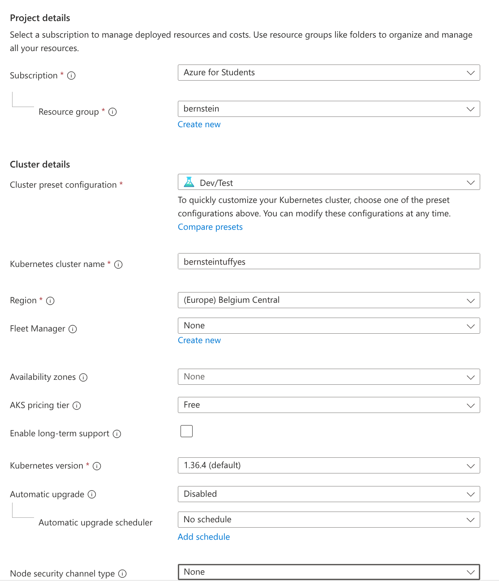
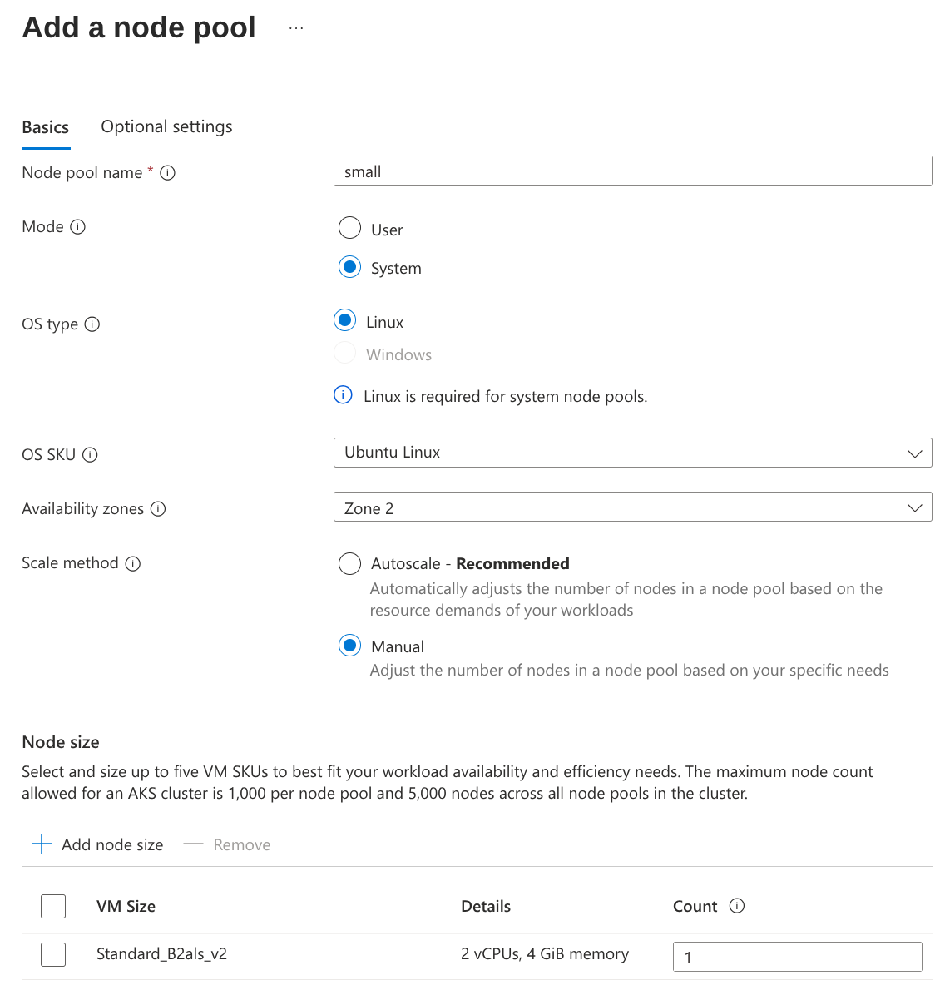

# Kubernetes Cluster

This guide is going to use the Azure Kubernetes Cluster as an example.

## Create your Kubernetes Cluster

Overview page:



On the overview page, select "Belgium Central" as the regions.

> I found it much easier for Azure for Students.

Node pools page:



> This is simply the cheapest node pool on Azure

Integrations page:

Select the container registry you created earlier.

## Connecting to the cluster

> K8s credentials are not available from the portal UI.
> ([Source](https://stackoverflow.com/questions/62027328/get-kubectl-credentials-in-azure))

Here's how I got the credentials for the cluster:

```sh
nix shell nixpkgs#azure-cli # Not needed if you don't use Nix, install it via your package manager
az login                    # Not needed if you are already logged in
az aks get-credentials --name "cluster-name" --resource-group "resource-group"
```

> You can also probably use the Azure Cloud Shell
